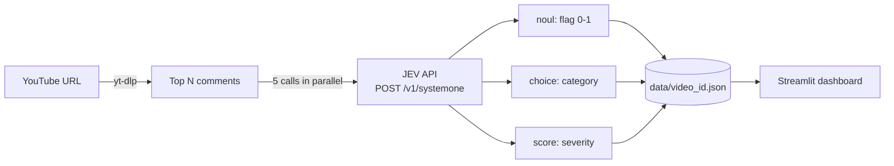
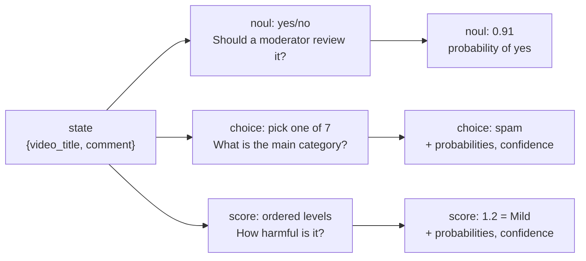

# JEV Demo Application: YouTube Comment Moderation

## 1. What the app does

The app takes a YouTube video link, downloads its top comments, and asks JEV three questions about each comment:

| Question | JEV type | What it answers | Output |
|---|---|---|---|
| `flag` | `noul` (yes/no) | Should a moderator review this comment? | Probability from 0 to 1 |
| `category` | `choice` (pick one) | What kind of comment is it? `clean`, `spam`, `self_promotion`, `harassment`, `hate_speech`, `misinformation`, `off_topic` | Top option, probability of each option, confidence |
| `severity` | `score` (ordered levels) | How harmful is it? `None`, `Mild`, `Moderate`, `Severe` | Weighted score, probability of each level, confidence |

All three questions go in **one API call per comment**. The results are saved and shown on a dashboard with charts, token counts, and cost.

## 2. How it works



**What each question type does** (one request, three questions, example answers):



- **`noul`** answers a yes/no question with one number from 0 to 1, the probability of "yes". We choose the cut-off (threshold) ourselves.
- **`choice`** picks the single best option from a list we define, and gives the probability of every option.
- **`score`** places the comment on an ordered scale we define (None to Severe). It returns a weighted average level, so the value can fall between two levels, plus the probability of each level.

1. The user pastes a YouTube link and types how many comments to fetch (default 50, max 200).
2. `yt-dlp` downloads the top comments (no replies).
3. Each comment is sent to JEV together with the video title. The title helps JEV judge `off_topic` and `misinformation`.
4. JEV answers the three questions. The app saves the raw answers and token usage to `data/<video_id>.json`.
5. The dashboard reads all saved files and shows charts, a table, and cost.

**Stack:** Python 3.12 (managed by `uv`), Streamlit, Plotly, pandas, `yt-dlp`, `python-dotenv`, and TypeSafe's official Python SDK (`typesafe-sdk`). The SDK handles the HTTP call, retries, and compression. The app still saves the raw JSON response (`result.raw_http_response.json()`), so the dashboard and this report can show exactly what JEV sends back.

```python
from typesafe_sdk import TypeSafeClient

with TypeSafeClient() as client:  # reads TYPESAFE_API_KEY
    result = client.system_one(state, questions)
raw = result.raw_http_response.json()
```

**Code layout:**

```
app.py                  # entry point: page setup, sidebar settings, sections in order
jev.py                  # JEV logic: questions, SDK call, yt-dlp fetch, save/load, cost
sections/
  common.py             # shared: settings, routing rule, Mermaid diagrams, progress + errors
  how_it_works.py       # section 1
  fetch.py              # section 2
  dashboard.py          # sections 3-8
  live.py               # section 9
  thai_compare.py       # section 10
```

**Dashboard sections:**

1. How it works: flow diagram, the Python SDK call, and the raw request and response JSON for one real comment
2. Fetch: URL box, comment count box (max 200), "Fetch & analyze" button
3. Summary: number of comments, % flagged, % handled automatically, input tokens, cost, average cost per comment, projected cost per 1,000 and 1,000,000 comments
4. `noul` panel: histogram of flag probability, with a line at the flag threshold and a shaded "unsure" band
5. `choice` panel: number of comments per category, by video
6. `score` panel: number of comments per severity level, by video
7. Confidence: what happens to each comment (auto-keep, auto-flag, human review), and choice confidence by category
8. Table of every comment with its answers, confidence, and action, plus CSV download
9. Try your own comment: type any text and see JEV's answers, confidence, action, tokens, and cost live
10. Thai comparison: the same comments asked with English questions and with Thai questions, side by side

The sidebar holds the price, the flag threshold, the confidence cut-off, and a video filter. The filter applies to sections 3 to 8.

**Saved data format** (`data/<video_id>.json`):

```json
{
  "video_id": "abc123",
  "title": "Video title",
  "url": "https://www.youtube.com/watch?v=abc123",
  "fetched_at": "2026-10-19T13:00:00+00:00",
  "model": "jev-1.13.0",
  "comments": [
    {"id": "...", "author": "@someone", "likes": 120, "text": "...",
     "response": {"model": "...", "answers": {"flag": {}, "category": {}, "severity": {}}, "usage": {"input_tokens": 0, "output_tokens": 0}}}
  ]
}
```

The Thai comparison is saved the same way in `data/thai_questions/<video_id>.json`. A comment that failed has an `"error"` field instead of `"response"`. The `model` field records the exact JEV version, because `jev-latest` points to a new version when TypeSafe updates it.

## 3. Design decisions

| Topic | What we chose | Other options | Why |
|---|---|---|---|
| Purpose | A demo for this report | A tool for daily use | We need to show what JEV can do, not run a real service. |
| Use case | Comment moderation | Ticket triage, lead scoring | Moderation needs all three JEV question types, and comments are easy to get. |
| Question types | One `noul`, one `choice`, one `score` in one call | Several `noul` questions (one per category) | Each type does a clear, separate job, so the report shows all three. |
| Category | One main category per comment (`choice`) | Many labels per comment (one `noul` per label) | `choice` returns only one option. Multi-label is listed under Future work. |
| Data source | YouTube comments via `yt-dlp` | YouTube Data API, hand-written CSV | No Google key needed, and the comments are real. |
| How data comes in | Only through the URL box in the app | A separate batch script | One code path instead of two. |
| Comments per video | Top 50 by default, typed in a number box, max 200, no replies | All comments, include replies | Fast, cheap, and enough to see patterns. Replies add noise. |
| Project shape | One project, one page | A separate project per question type | All three types come from the same API call. |
| UI | Streamlit + Plotly | React / Next.js | Much faster to build. Charts and tables come built in. |
| Results | Saved to files, plus a live "try your own comment" box | Live calls only | Saved results make charts stable for screenshots. The live box shows JEV working in real time. |
| Storage | One JSON file per video in `data/` | Database, one big CSV | Nothing to set up. Fetching a video again replaces only its file. CSV is available as a download. |
| Speed | 5 calls in parallel | One call at a time | 50 calls one by one is slow. 5 parallel calls stays far below the reported limit (1,200 requests per minute). |
| API client | Official Python SDK (`typesafe-sdk`), saving the raw JSON response | Plain HTTP calls | The SDK gives retries, typed errors, and compression for free. Saving the raw response still lets us show what JEV really returns. |
| Errors | The SDK retries `408`, `429`, and `5xx` (including `529`) up to 4 times with growing wait time, and follows `Retry-After`. Skip a comment on other errors and save the reason. Stop the whole run on `401` (bad key). | Stop on any error | The TypeSafe docs say to retry `429` and `529`. One bad comment should not stop the run, but a bad key should. |
| Question language | English questions by default, comments sent as they are (Thai or English) | Thai questions by default | TypeSafe says English is JEV's main language. Section 10 of the app tests Thai questions on the same comments, so we can compare. |
| Thai comparison | Ask the same saved comments again with Thai questions, using the exact JEV version from the English run. Choice keys stay in English, only the descriptions are translated. | Fetch new comments; use `jev-latest` | Same comments and same model version, so the only difference is the question language. |
| Confidence routing | The flag decides the action. If flag confidence `\|2p − 1\|` is below the cut-off (default 0.5), the comment goes to a person. | Route on the lowest of all three confidences | The flag is what triggers an action. Choice confidence with 7 options is naturally lower, so using it would send too many normal comments to a person. Category and severity confidence are still shown. |
| Video context | Send the video title with each comment | Comment text only | JEV cannot judge `off_topic` or `misinformation` without knowing what the video is about. |
| Cost display | `input_tokens x price / 1,000,000`, fixed price shown in the sidebar | Price editable in the app | One fixed price keeps the numbers in the report consistent. If TypeSafe changes the price, update `PRICE_PER_M` in `jev.py`. |
| LLM comparison | Not included yet | Run the same task with a generative LLM | A fair comparison needs a second API key and real calls. Guessed numbers would weaken the report. |
| API key | Read from `TYPESAFE_API_KEY` in `.env` | Typed into the app | The key never appears in saved files, screenshots, or git. |
| Git | `.env` and `data/` are not committed | Commit everything | Keeps the key private and keeps scraped comments out of the repository. |

## 4. Cost

**Formula:** `cost = input_tokens x price_per_million / 1,000,000`

- **Price used:** $0.042 per 1 million input tokens. Output tokens are free.
- **Note:** this price comes from secondary sources ([Flavio Copes](https://flaviocopes.com/jev-pricing/), [eesel.ai](https://www.eesel.ai/blog/typesafe-jev-pricing), checked October 2026). TypeSafe has no official pricing page (`typesafe.ai/pricing` returns 404), and TypeSafe says the price may change. If it does, update `PRICE_PER_M` in `jev.py`.
- **Token counts are real:** they come from the `usage` field of each JEV response, not from an estimate.
- The dashboard shows total cost, average cost per comment, and projected cost for 1,000 and 1,000,000 comments.

| | Value |
|---|---|
| Total comments analyzed | _TODO_ |
| Total input tokens | _TODO_ |
| Total cost | _TODO_ |
| Average cost per comment | _TODO_ |
| Projected cost per 1,000,000 comments | _TODO_ |

## 5. Confidence

### What it is

Confidence is a number from 0 to 1 that tells how sure JEV is about an answer ([TypeSafe docs](https://docs.typesafe.ai/confidence.md)).

- **1** means all the probability is on one answer: JEV is sure.
- **0** means the probability is spread evenly: JEV has no idea.

It is calculated from the probabilities JEV already returns, so it costs nothing extra.

| Type | Has `confidence`? | How it is calculated |
|---|---|---|
| `noul` | No. The probability itself shows how sure JEV is. | We use `\|2p − 1\|` as the docs suggest: 0 at p = 0.5 (unsure), 1 at p = 0 or 1 (sure). |
| `choice` | Yes | `(top probability − 1/n) / (1 − 1/n)`, where n is the number of options. Only the top option counts. |
| `score` | Yes | Like `choice`, but levels are ordered: spread to a nearby level (Mild vs Moderate) lowers confidence less than spread to a far level (None vs Severe). |

Confidence is not the same as probability. Probability says how likely each answer is. Confidence says how clear the winner is.

### How the app uses it

TypeSafe's docs recommend acting automatically when confidence is high and sending the item to a person when it is low. The app follows that rule:

1. **Routing rule.** Every comment gets one action:
   - **Auto-flag**: the flag probability is at or above the threshold, and JEV is sure.
   - **Auto-keep**: the flag probability is below the threshold, and JEV is sure.
   - **Human review**: flag confidence is below the cut-off (default 0.5, i.e. flag probability between 0.25 and 0.75).
2. **Summary tile "Auto-handled"** shows the share of comments that need no person. This is the main value of confidence: a moderator only reads the unsure part.
3. **`noul` chart** shades the "unsure" band, so you can see which comments fall into it.
4. **Confidence section** shows how many comments get each action, and a box plot of `choice` confidence per category. Low boxes show categories JEV finds hard to tell apart.
5. **Table and CSV** include every confidence value and the action.
6. **Try your own comment** shows confidence next to each answer, and the action.
7. **Thai comparison** compares average confidence between English and Thai questions.

Both the threshold and the cut-off are sliders, because the right values depend on the data. The docs say to start careful, test on your own data, and adjust.

## 6. Thai comments: English questions vs Thai questions

### Method

1. Fetch a Thai video. JEV answers its comments with the English questions.
2. In section 10 of the app, click "Run Thai questions on this video". JEV answers the same comments again with the questions translated to Thai.
3. Both runs use the exact same JEV version, so only the question language changes.
4. The app shows a summary table, the agreement rates, and a table per comment. Both can be downloaded as CSV.

The Thai questions are our own translation. A native speaker should check them before we trust the results.

**The questions, English vs Thai** (defined in `jev.py` as `QUESTIONS` and `QUESTIONS_TH`):

| Question | Part | English | Thai |
|---|---|---|---|
| flag (noul) | `instructions` | Should a moderator review this YouTube comment? | ผู้ดูแลควรตรวจสอบความคิดเห็น YouTube นี้หรือไม่? |
|  | `true` | The comment may break community rules: spam, scams, harassment, hate, or harmful misinformation. | ความคิดเห็นอาจละเมิดกฎของชุมชน: สแปม การหลอกลวง การคุกคาม ความเกลียดชัง หรือข้อมูลเท็จที่เป็นอันตราย |
|  | `false` | A normal comment that is safe to keep. | ความคิดเห็นปกติที่เก็บไว้ได้อย่างปลอดภัย |
| category (choice) | `instructions` | What is the main category of this YouTube comment? | ความคิดเห็น YouTube นี้อยู่ในหมวดหมู่หลักใด? |
|  | `clean` | Normal comment: opinion, praise, question, or discussion about the video | ความคิดเห็นปกติ: ความเห็น คำชม คำถาม หรือการพูดคุยเกี่ยวกับวิดีโอ |
|  | `spam` | Scams, bots, repeated text, fake giveaways, suspicious links | การหลอกลวง บอท ข้อความซ้ำ ๆ แจกของปลอม ลิงก์น่าสงสัย |
|  | `self_promotion` | Advertising own channel, product, or social media | โฆษณาช่อง สินค้า หรือโซเชียลมีเดียของตัวเอง |
|  | `harassment` | Insults or attacks against a person, the creator, or other commenters | ดูถูกหรือโจมตีบุคคล ผู้สร้างวิดีโอ หรือผู้แสดงความคิดเห็นคนอื่น |
|  | `hate_speech` | Attacks on a group based on race, religion, gender, nationality, etc. | โจมตีกลุ่มคนจากเชื้อชาติ ศาสนา เพศ สัญชาติ ฯลฯ |
|  | `misinformation` | False or misleading claims presented as fact | อ้างข้อมูลเท็จหรือชวนให้เข้าใจผิดราวกับเป็นข้อเท็จจริง |
|  | `off_topic` | Unrelated to the video | ไม่เกี่ยวข้องกับวิดีโอ |
| severity (score) | `instructions` | How harmful is this YouTube comment? | ความคิดเห็น YouTube นี้เป็นอันตรายแค่ไหน? |
|  | `None` | None: harmless | ไม่มี: ไม่เป็นอันตราย |
|  | `Mild` | Mild: rude or annoying | เล็กน้อย: หยาบคายหรือน่ารำคาญ |
|  | `Moderate` | Moderate: insulting, misleading, or clearly unwanted | ปานกลาง: ดูถูก ชวนให้เข้าใจผิด หรือไม่พึงประสงค์อย่างชัดเจน |
|  | `Severe` | Severe: hateful, threatening, or dangerous | รุนแรง: แสดงความเกลียดชัง ข่มขู่ หรือเป็นอันตราย |

### Results

_To fill in after running the app on a Thai video._

| | English questions | Thai questions |
|---|---|---|
| JEV model | _TODO_ | _TODO_ |
| Comments answered | _TODO_ | _TODO_ |
| Avg flag probability | _TODO_ | _TODO_ |
| Flagged (≥ threshold) | _TODO_ | _TODO_ |
| Avg flag confidence | _TODO_ | _TODO_ |
| Avg category confidence | _TODO_ | _TODO_ |
| Avg severity confidence | _TODO_ | _TODO_ |
| Sent to human review | _TODO_ | _TODO_ |
| Avg input tokens / comment | _TODO_ | _TODO_ |
| Total cost (USD) | _TODO_ | _TODO_ |

| Agreement | Value |
|---|---|
| Same category | _TODO_ |
| Same severity | _TODO_ |
| Same flag decision | _TODO_ |

**How to read it:**

- **Agreement is not accuracy.** If both runs give the same answer, JEV is consistent across languages. It does not prove the answer is right.
- **Higher confidence** with one question language suggests JEV understands that version more clearly.
- **Token difference is real cost.** Thai text usually needs more tokens, so Thai questions may cost more per comment.

## 7. Results

_To fill in after running the app on the chosen videos._

| Video | Topic | Language | Comments | % flagged | Most common category |
|---|---|---|---|---|---|
| _TODO_ | | | | | |

**Screenshots:** _TODO_

**Observations:**

- `noul` (flag): _TODO_
- `choice` (category): _TODO_
- `score` (severity): _TODO_
- Thai comments: _TODO_ (see section 6 for the English vs Thai question comparison)

## 8. Limitations

- **Pricing is not official.** The cost numbers depend on a price found in secondary sources.
- **Thai is less accurate.** TypeSafe's docs say English is JEV's main training language. Other languages are accepted but "currently less accurate" ([State docs](https://docs.typesafe.ai/concepts/state.md)). Section 6 compares English and Thai questions, but without hand-labeled comments it shows consistency, not accuracy.
- **Thai questions are our own translation.** They have not been checked by a native speaker.
- **Cut-off values are starting points.** The flag threshold (0.5) and confidence cut-off (0.5) are defaults, not tuned on labeled data.
- **One category per comment.** `choice` picks a single category. A comment that is both spam and harassment gets only one label.
- **No ground truth.** We did not label comments by hand, so we cannot measure accuracy. The results show what JEV says, not whether it is right.
- **YouTube terms.** Downloading comments with `yt-dlp` is a grey area under YouTube's Terms of Service. We use it only for a small internal research sample and do not publish the raw comments.
- **Model version changes.** `jev-latest` can point to a newer version later, so results may change. Each saved file records the exact version.

## 9. Future work

- Compare cost, speed, and accuracy with a generative LLM on the same comments.
- Allow many labels per comment by asking one `noul` question per category.
- Label a small sample by hand to measure JEV's accuracy.
- Connect live sources (for example a channel's new comments) instead of manual links.

## 10. How to run

```bash
uv sync
echo "TYPESAFE_API_KEY=your-key-here" > .env
uv run streamlit run app.py
```

Without a key, the app still opens, but fetching and the live box are turned off.
